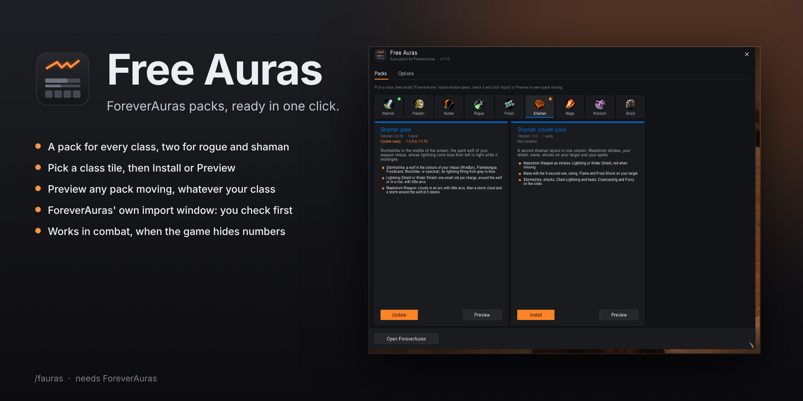
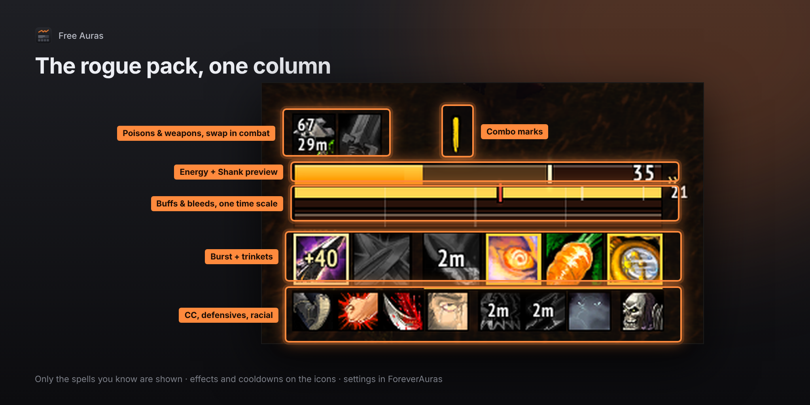

<h1 align="center">Free Auras</h1>

Ready-made ForeverAuras packs, installed in one click: a clean rogue column, and a shaman storm with Stormstrike as a spirit wolf, shield orbs and Maelstrom clouds.

<a href="https://www.curseforge.com/wow/addons/free-auras"><b>Download on CurseForge</b></a> · version <b>1.1.0</b> · WoW Forever (1.60.1) · <code>/fauras</code>

## Screenshots

<table>
<tr>
<td width="100%" valign="top"> <b>The rogue pack, one column</b> Poisons and weapons, combo marks, energy with the Shank preview, buffs and bleeds on one time scale, cooldowns with their effects.</td>
</tr>
</table>

Aura packs for **ForeverAuras**, ready to use. Pick a pack, click **Install**, check it in ForeverAuras' import window, done. The pictures the packs use come with the addon.

## Installing and updating

- `/fauras` (or the Free Hub button) opens the list of packs, your class first.
- **Install** opens ForeverAuras' own import window: you see what comes in and click Import. Nothing is installed behind your back.
- When a pack gets better, the addon tells you once at login and the button becomes **Update**: ForeverAuras' update window lets you keep your own positions and settings.
- Every aura has its settings in ForeverAuras, **Custom Options** tab.

## Rogue pack

A compact column under your character, 200 pixels wide, everything lined up:

- **Combo points** as hand-drawn tally marks, a stroke at a time; the fifth one crosses the four others.
- **Energy** with a **Shank** cursor: where Shank will take your energy (Flash of Steel included, read from the spell), red when it would overflow.
- **Slice and Dice, Blade Flurry, Adrenaline Rush, and your Rupture and Garrote on the target, on one time scale**: the bars end at the same place when they end together, a gold line shows until when they all run. The scale is at least 15 seconds and stretches smoothly to the longest one.
- On the Slice and Dice line, marks show where a cast **now** would end with your combo points, and with more points.
- **Cooldowns in two rows**, always the full width: Shank and Riposte (lit after a parry), then your burst (Blade Flurry, Adrenaline Rush, trinkets, an offensive racial) with the wait until all of them are ready; below, Kick, Kidney Shot, Gouge, Blind, then Evasion, Sprint, Vanish and your racial.
- **Effects on the icons**: while Kidney Shot, Gouge or Blind holds your target, or Evasion, Sprint, Vanish, Blade Flurry or Adrenaline Rush runs on you, the icon shows the time left with a draining line, then the cooldown.
- **Trinkets**: left click uses one, right click (out of combat) lists the trinkets in your bags to put on.
- **Weapons and poisons**: your two weapons side by side with their poison (charges, time left); a weapon without poison is simply greyed out. Left click lists the poisons in your bags and applies the one you pick; right click lists the weapons for that hand. **Both work in combat.**
- Optional: Slice and Dice as a stylised lightning bolt.
- Only the spells you know are shown: it works from level 1.

## Shaman pack

One aura in the middle of the screen, for Enhancement:

- **Stormstrike as a spirit wolf** in the colours of your weapon imbue (Windfury, Flametongue, Frostbrand, Rockbiter, or a spectral wolf without one), always in full colour. The lightning under it turns from grey to blue, left to right, while Stormstrike recharges, and flashes once when it is ready again (Improved Stormstrike resets included). The wolf follows an imbue cast in combat too.
- **Lightning Shield or Water Shield**: one small orb per charge with little arcs of lightning, turning around the wolf or in a row (left, below, right); you choose which charge goes first.
- **Maelstrom Weapon**: small clouds in an arc above the wolf (left, right, left, right), then the storm cloud in the middle at 5 stacks, with a storm around the wolf (both the storm and the burst at 5 can be turned off).
- **In combat too**, when the game hides charges and stacks from addons: each orb and cloud is shown by a native aura slot that the game fills itself.
- Sizes, distances, turning direction, cloud direction and a **Demo** mode (a fake fight) in the aura's Custom Options.

## Requirements

- **ForeverAuras** (the aura addon of WoW Forever).
- Keep Free Auras enabled while you use its packs: their pictures are in it.

## Free Hub

Free Auras works on its own. With **Free Hub** installed, it opens inside the hub next to the other Free addons, and a single minimap button replaces theirs.

## The Free suite

Addons for WoW Forever that share the same look, profiles and a single minimap button through Free Hub.

| | Addon | |
|---|---|---|
|  | **[Free Hub](https://github.com/DecardCainSuite/FreeHub)** — All the Free addons in one window: options side by side, product pages with gallery, and a single minimap button. | [CurseForge](https://www.curseforge.com/wow/addons/free-hub) |
|  | **[Free Unit Frames](https://github.com/DecardCainSuite/FreeUnitFrames)** — Fully customisable unit frames for player, target, focus, party, raid and bosses, with an ElvUI-style preset in one click. | [CurseForge](https://www.curseforge.com/wow/addons/freeunitframes) |
|  | **[Free Bars](https://github.com/DecardCainSuite/FreeBars)** — Up to 9 action bars, laid out as a grid or an arc, with mouseover fade, paging and a clean flat look. | [CurseForge](https://www.curseforge.com/wow/addons/freebars) |
|  | **[Free Swing](https://github.com/DecardCainSuite/FreeSwing)** — Swing timers for main hand, off hand and ranged, at exactly the size and style you want. | [CurseForge](https://www.curseforge.com/wow/addons/freeswing) |
|  | **[Free Minimap](https://github.com/DecardCainSuite/FreeMinimap)** — A rectangular minimap of any size, with a region map drawn from the game's own terrain tiles around you. | [CurseForge](https://www.curseforge.com/wow/addons/freeminimap) |
|  | **[Free Guild](https://github.com/DecardCainSuite/FreeGuild)** — Guild roster and rank tool for guild masters and officers: filters, bulk ranks, rules that promote for you, stats, raid rosters with attendance, guild info and notes. | [CurseForge](https://www.curseforge.com/wow/addons/freeguild) |
|  | **[Free LFG](https://github.com/DecardCainSuite/FreeLFG)** — The group finder as a compact, sortable table: leader, roles, free slots, one-click whisper from a template, and live filters you write yourself. | [CurseForge](https://www.curseforge.com/wow/addons/freelfg) |
|  | **[Free Auras](https://github.com/DecardCainSuite/FreeAuras)** (this one) — Ready-made ForeverAuras packs, installed in one click: a clean rogue column, and a shaman storm with Stormstrike as a spirit wolf, shield orbs and Maelstrom clouds. | [CurseForge](https://www.curseforge.com/wow/addons/free-auras) |

## Changelog

What is new in the current version: [CHANGELOG.md](CHANGELOG.md). Full history: [CHANGELOG-history.md](CHANGELOG-history.md).

## Repository layout and releases

- The repository root is the addon folder (`FreeAuras/`), as installed in `Interface\AddOns`.
- `curseforge/` holds the CurseForge page: `description.md` (fields, gallery captions, description) and `images/` (logo, gallery, social preview). It is not shipped in the addon zip.
- `CHANGELOG.md` holds the notes of the version being prepared; they are sent to CurseForge as the file's changelog.
- The packs are built from the aura sources kept with the developer's tools; `Packs.lua` is generated, do not edit it by hand.
- Releasing: bump `## Version` in `FreeAuras.toc`, write `CHANGELOG.md`, then publish a GitHub release named `v<version>`. GitHub Actions packages the addon with the [BigWigs packager](https://github.com/BigWigsMods/packager) and uploads it to CurseForge and to the GitHub release.

Bug reports and ideas are welcome in the issues or in the CurseForge comments.
